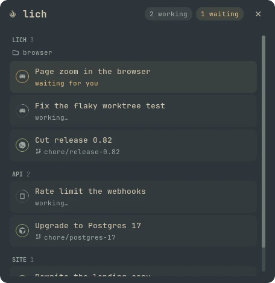

# lich Sessions

The sessions open in [lich](https://github.com/lichdotdev/lich), drawn the way lich's own sidebar draws them:
grouped by project and sidebar folder, each card with the agent's mark in a status ring that spins while the agent
works, turns amber when it waits for you and green when its turn is done.



## Entries

| Entry | Kind | What it shows |
| --- | --- | --- |
| `bar` | Bar widget | The lich mark, how many sessions are working, and an amber badge with how many wait for you. Click it to open the panel. |
| `panel` | Panel | Every session by project and folder, with its branch. Click a card to bring lich forward with that session open. |
| `desktop` | Desktop widget | The same list, read-only, for the desktop or the lock screen. |
| `service` | Service | Polls lich and sends a notification when a session starts waiting for you. |

## Settings

| Setting | Entries | Default | What it does |
| --- | --- | --- | --- |
| `order` | `panel`, `desktop` | `attention` | `attention` puts the sessions waiting for you first, then the working ones; `lich` keeps lich's sidebar order. |
| `max_sessions` | `desktop` | `8` | How many cards the desktop widget shows (1-30), with a "+N" line for the rest. Desktop widgets cannot scroll. |

Add the bar widget from the bar's *Add widget* picker and the desktop widget from the desktop or lock-screen widget
editor. Shell sessions are left out.

Open the panel from a keybind with:

```sh
noctalia msg panel-toggle lichdotdev/lich-sessions:panel
```

## Dependencies

- `lich` on `PATH`, running.
- `git`, for the branch of each project's own checkout.

## What it runs

Every process the plugin starts, all read-only except `lich focus`:

| Command | When |
| --- | --- |
| `lich sessions --json` | Every 3 seconds. |
| `lich folders --project <dir> --json` | Every 15 seconds, once per project. |
| `lich worktrees --project <dir> --json` | Every 15 seconds, once per project. |
| `git -C <dir> branch --show-current` | Every 15 seconds, once per project. |
| `lich focus --project <dir> <session>` | When you click a card in the panel. |

It makes no network calls. It writes only the ring and mark SVGs, in the active palette's colors, under its own
plugin data directory, one set per palette.

## Credits

The provider marks are from [Lobe Icons](https://github.com/lobehub/lobe-icons) (MIT, © 2023 LobeHub), taken from
lich's own icon set.
